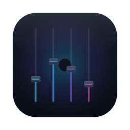

# Mac Volume Mixer (MVM) 🎛️

<div align="center">
  
</div>

[🇹🇷 Türkçe sürüm için aşağı kaydırın (Turkish version below)](#türkçe-tr)

Mac Volume Mixer (MVM) is a native menu bar application for macOS that allows you to control the audio volume of individual applications separately. Unlike other tools, MVM does not require any third-party virtual audio drivers (such as BlackHole). It utilizes native macOS Core Audio APIs introduced in macOS 14 for zero-latency, echo-free audio management.

<p align="center">
  
</p>

## ✨ Features
- **Per-App Volume Control:** Adjust or mute the volume of any active application independently.
- **Master Control:** Adjust the global output volume or mute all applications instantly.
- **Zero Virtual Drivers:** Purely native implementation. No kexts or virtual drivers.
- **Echo-Free Audio:** Utilizes hardware-level muting (`.mutedWhenTapped`) to prevent audio duplication.
- **Real-Time Discovery:** Dynamically detects when an app starts/stops playing audio (indicated by a green dot).

## 🧠 How It Works
MVM leverages **Core Audio Process Taps** (`CATapDescription`), a modern API available in macOS 14.2+. It dynamically detects audio-producing apps, creates a Process Tap to capture their audio buffer, and suppresses the original hardware output to prevent echoing. The audio is then routed through a real-time `AVAudioEngine` instance for volume mixing.

## 📥 Installation
1. Go to the [Releases](../../releases/latest) page and download `MVM.zip`.
2. Extract the ZIP and move `MVM.app` to your `/Applications` folder.
3. Launch the application.

> **⚠️ Important Permission Note:** Upon first launch, MVM will request **Screen & System Audio Recording** permission. Navigate to `System Settings > Privacy & Security > Screen & System Audio Recording`, grant access to MVM, and relaunch.

## 🛠️ Build from Source
**Requirements:** macOS 14.2+, Xcode 15+

```bash
git clone [https://github.com/burakozturk1/MVM_APP.git](https://github.com/burakozturk1/MVM_APP.git)
cd MVM_APP
```

Open `MVM.xcodeproj` in Xcode and press `Cmd + R` to build and run.

---

# Türkçe (TR)

**Mac Volume Mixer (MVM)**, macOS üzerinde çalışan uygulamaların ses seviyelerini birbirinden bağımsız olarak kontrol etmenizi sağlayan yerel (native) bir menü çubuğu uygulamasıdır. Diğer araçların aksine sanal ses sürücülerine (BlackHole vb.) ihtiyaç duymaz. macOS 14 ile gelen yerel Core Audio API'lerini kullanarak gecikmesiz ve yankısız bir ses yönetimi sunar.

## ✨ Özellikler
- **Uygulama Bazlı Ses Kontrolü:** Her uygulamanın ses seviyesini ayrı ayrı ayarlayın veya tamamen kapatın.
- **Genel (Master) Kontrol:** Tüm sistemin sesini tek bir kaydırıcı ile kontrol edin veya anında sessize alın.
- **Sürücüsüz Çalışma:** Ekstra hiçbir sanal sürücü kurmanıza gerek yoktur. Tamamen yerel API'lerle çalışır.
- **Yankısız Ses (Echo-Free):** Donanım seviyesinde susturma yaparak sesin çift gelmesini (yankı) engeller.
- **Eşzamanlı Algılama:** Hangi uygulamanın o an ses çıkışı verdiğini otomatik algılar (yeşil gösterge ile belirtilir).

## 🧠 Nasıl Çalışır?
MVM, macOS 14.2+ ile gelen **Core Audio Process Taps** mimarisini kullanır. Ses üreten uygulamaları dinamik olarak tespit eder, hedef uygulama için bir Process Tap oluşturup ses tamponunu (buffer) yakalar ve yankıyı önlemek için orijinal çıkışı donanım seviyesinde susturur. Yakalanan ses, `AVAudioEngine` üzerinden karıştırılıp ana donanıma iletilir.

## 📥 Kurulum
1. [Releases](../../releases/latest) sayfasından en güncel `MVM.zip` dosyasını indirin.
2. ZIP dosyasını çıkartın ve içindeki `MVM.app` dosyasını `Uygulamalar (Applications)` klasörüne taşıyın.
3. Uygulamayı çalıştırın.

> **⚠️ Önemli İzin Uyarısı:** Uygulamanın diğer seslere erişebilmesi için **Ekran ve Sistem Sesi Kaydı** iznine ihtiyacı vardır. `Sistem Ayarları > Gizlilik ve Güvenlik > Ekran ve Sistem Sesi Kaydı` menüsüne gidin, MVM'ye izin verin ve uygulamayı yeniden başlatın.

## 🛠️ Kaynaktan Derleme
**Gereksinimler:** macOS 14.2+, Xcode 15+

```bash
git clone [https://github.com/burakozturk1/MVM_APP.git](https://github.com/burakozturk1/MVM_APP.git)
cd MVM_APP
```

`MVM.xcodeproj` dosyasını Xcode ile açın ve derlemek için `Cmd + R` tuş kombinasyonunu kullanın.

---

## 📄 License / Lisans
This project is open-source and available under the [MIT License](LICENSE).
Copyright (c) 2026 Burak Öztürk.
